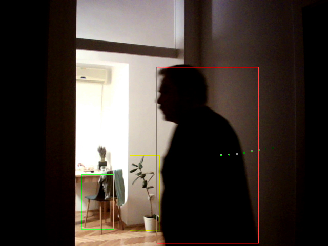
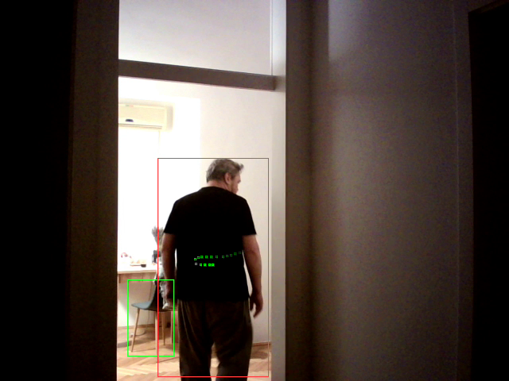
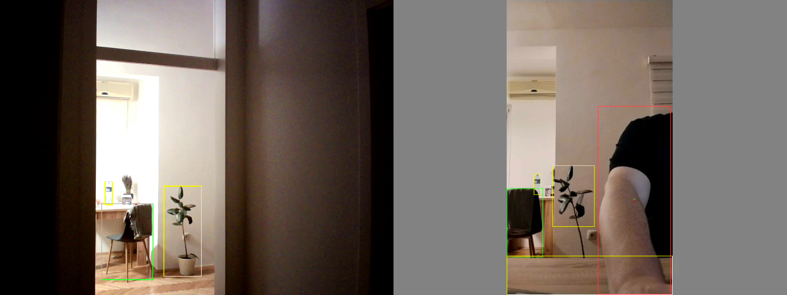
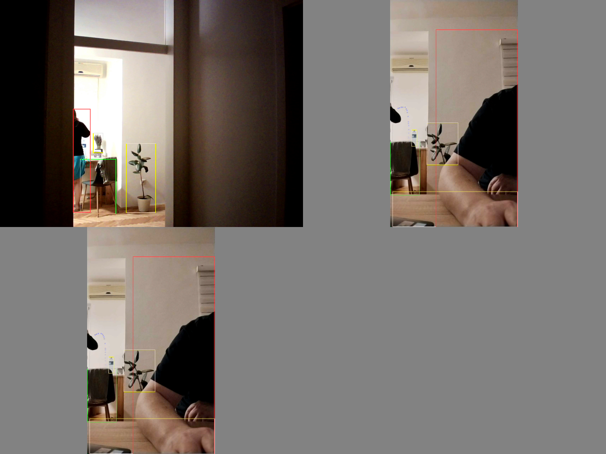
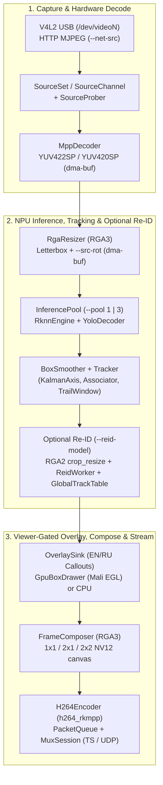

# `light_ai` — Zero-Copy Video Analytics on RK3588

[](LICENSE)
[-green.svg)](#requirements--platform-constraints)
[](CMakeLists.txt)
[](#tests)

Zero-copy hardware-accelerated object detection, Kalman tracking, optional OSNet cross-camera Re-ID, and multi-camera H.264 streaming pipeline for Rockchip RK3588 (`V4L2` / HTTP MJPEG → `MPP` decode → `RGA3` letterbox & rotation → `RKNN` NPU + async Re-ID → `Mali G610` EGL/GLES box, EN/RU callout & trail overlay → `MPP` H.264 / MPEG-TS). Built in C++17 with no GStreamer, no OpenCV, no CPU pixel copies, and no virtual dispatch on the frame path.

## Table of Contents

- [Live Captures](#live-captures)
- [Quickstart](#quickstart)
- [Architecture & Pipeline](#architecture--pipeline)
- [Modules & Headers](#modules--headers)
- [Error Model & Exit Codes](#error-model--exit-codes)
- [Build & Static Analysis](#build--static-analysis)
- [Tests](#tests)
- [Run & CLI Reference](#run--cli-reference)
- [Requirements & Platform Constraints](#requirements--platform-constraints)
- [Measured Performance](#measured-performance)
- [Scripts & Tools](#scripts--tools)
- [Documentation & Licenses](#documentation--licenses)

---

## Live Captures

Sample output frames captured directly from the encoded H.264 preview stream on the RK3588 board (`yolov5s_relu_int8_mmse_v5.rknn`, `GpuBoxDrawer` + Kalman `Tracker` + `TrailWindow`):

| Single Camera: Seated Person & Multi-Class (`640×480`) | Single Camera: Walking Detection & Green Trail (`640×480`) |
|---|---|
|  |  |
| **Dual Source `2×1`: Live Tracking + `NO SIGNAL` (`1280×480`)** | **Dual Source `2×1`: Mixed V4L2 + Portrait HTTP MJPEG (`1280×480`)** |
|  |  |
| **Multi-View `2×2` Grid: `NO SIGNAL` Failover (`1280×960`)** | **Multi-View `2×2` Grid: 3 Active Mixed-Aspect Streams (`1280×960`)** |
|  |  |

---

## Quickstart

Run from `light_ai/` inside your repository checkout on an RK3588 board *(on boards booting from eMMC with an external NVMe or USB SSD attached, keep the checkout on the external drive to avoid eMMC flash wear)*:

```bash
# 1. Build + run host unit tests (54 suites) + TSan (5 suites) + 2-pass clang-tidy
./scripts/build.sh

# 2. Run host unit tests + ThreadSanitizer suites standalone
./scripts/test.sh

# 3. Run live inference + H.264/MPEG-TS TCP pull preview on port 1234
sudo -n ./build/light_ai --device /dev/video20 --pool 3 --net --net-h264 --net-fps 0
```

Connect a viewer from another host on the LAN:

```bash
ffplay -fflags nobuffer tcp://<board-ip>:1234
```

*(For Windows `mpv` configuration and latency tuning, see [`docs/viewer.md`](docs/viewer.md).)*

---

## Architecture & Pipeline



### Key Architectural Invariants

- **Zero-copy `dma-buf` pipeline:** Decoded YUV frames, RGA-letterboxed RGB888 NPU input tensors, GPU box overlays, and H.264 NV12 encoder inputs stay in `dma-buf` memory. CPU reads occur only when `--dump-cal` or `--cal` explicitly dumps a calibration PPM (`DmaSync`).
- **Output side vs. recognition gating:**
  1. **No viewer attached:** The output path sleeps completely — no GPU/CPU box drawing, no RGA compose, no `NO SIGNAL` tile generation, and no H.264 encoding (`enc` reports `0.0 ms`).
  2. **Recognition never sleeps:** Capture, MPP decode, RKNN inference, and Kalman tracking always run regardless of viewer state.
  3. **Viewer attached:** Online sources run the full render/compose/encode path; absent or disconnected sources display the pre-rendered gray `NO SIGNAL` tile (`IdlePlate` + `BitmapFont`).
- **Canonical stream canvases (`NetEncoder`):**
  - `1` source: `640×480` (letterbox band cropped 1:1 from NPU tensor).
  - `2` sources: `1280×480` side-by-side (`2×1` of `640×480` tiles).
  - `3–4` sources: `1280×960` grid (`2×2` of `640×480` tiles; unused 4th cell stays gray).
  - Multi-view sessions start on a gray canvas and hold frame `0` (session IDR) until all configured tiles have refreshed or `200 ms` elapses (`SessionWarmup`).
- **Thread & CPU affinity (`Pipeline`):** `SourceProber` runs on a single dedicated background thread spawned before `Pipeline::run()` pins the pipeline thread and NPU pool workers (`--pool 3`) to Cortex-A76 cores (`cpu 4–7`, `cpu_affinity.hpp`). When `--reid-model` is set, `ReidWorker` (`BasicReidQueue`) runs an additional asynchronous RKNN worker thread for person crops.

---

## Modules & Headers

The codebase contains **88 headers** under [`include/`](include/) and **55 translation units** under [`src/`](src/) + [`externals/inih/ini.c`](externals/inih/ini.c).

### Top-Level Pipeline & Hardware Modules (`include/`, `src/`)

| Header | Responsibility |
|---|---|
| `pipeline.hpp` | Top-level orchestration (`next_frame`, `step`, `publish_oldest`, A76 pinning) |
| `sources.hpp` | Umbrella convenience include for `source/` headers |
| `media_source.hpp` | Concrete `std::variant` owner of `CameraV4L2` and `NetMjpegSource` (static dispatch) |
| `camera_v4l2.hpp` | USB MJPEG V4L2 capture (`S_FMT`/`G_FMT`, mmap `DQBUF`/`QBUF`, hot-replug recovery) |
| `net_mjpeg_source.hpp` | HTTP `multipart/x-mixed-replace` MJPEG pull client |
| `mpp_decoder.hpp`, `rkmpp_drm_pool.hpp` | Rockchip MPP MJPEG → YUV422SP/YUV420SP decoder and external DRM `dma-buf` pool |
| `rga_resizer.h`, `dma_sync.hpp` | RGA3 `im2d` letterbox/rotation (`--src-rot`), per-call RGA2 `crop_resize` (RGB888 Re-ID crops), and `DMA_BUF_IOCTL_SYNC` guard |
| `rknn_engine.hpp` | RKNN zero-copy NPU engine (multi-slot `setup_io`, `bind_input_slot`, `sync_output`, native or INT8→FP16 outputs, move-only) |
| `inference_pool.hpp`, `infer_slot.hpp` | Multi-core NPU worker pool (`--pool 1` / `3`), ordered FIFO, bounded `5 s` wait & `Abandoned` slot handoff |
| `reid_worker.hpp` | Asynchronous Re-ID embedding runner (`RknnEngine` with 4 zero-copy slots + `BasicReidQueue` thread) |
| `yolo_postprocess.hpp`, `coco_names.h` | Worker-local `YoloDecode` wrapper and 80-class COCO label lookup table |
| `box_smoother.h`, `tracker.hpp` | 32-slot EMA smoother for non-person boxes (`cls != 0`) and 8-slot Kalman + greedy IoU tracker (`kMaxMiss = 6`, `global_id`, `gen`) |
| `box_mapper.h`, `overlay_sink.hpp` | Maps tracks, trails, EN/RU callouts, and non-person boxes; owns GPU/CPU draw parity + network output |
| `gpu_box_drawer.hpp` | Mali G610 EGL/GBM + GLES2/3 batched box, trail & `GL_ALPHA` callout label renderer (with CPU fallback) |
| `net_encoder.h`, `net_preview.hpp` | `h264_rkmpp` MPEG-TS encoder facade (`= default` dtor) and raw RGB24 NUT preview server |
| `tcp_pull_server.hpp`, `av_common.hpp`, `muxer_teardown.hpp` | Single-viewer TCP pull transport (`TCP_NODELAY`, `2 MiB` `SO_SNDBUF`, `15 s` `SO_SNDTIMEO`, `abort_client()`), FFmpeg helpers, RAII muxer teardown |
| `cal_dumper.hpp`, `jpeg_probe.hpp` | `--dump-cal` / `--cal` PPM writer and JPEG `SOFn` + EXIF `Orientation` probe |
| `console_reporter.h`, `timings.hpp`, `frame_trace.h` | Throttled detection/track reporter (`id=G(L...)` when Re-ID remaps) and per-stage `avg/60` + `TOTAL` timing accumulator |
| `cpu_affinity.hpp`, `process_env.hpp`, `signal_waiter.hpp` | Cortex-A76 affinity pinning, signal mask + `SIGPIPE` setup, `sigtimedwait` → `StopFlag` bridge |
| `pod_list.hpp`, `pod_ring.hpp`, `throw_on.hpp` | Zero-heap fixed-capacity containers (`PodList<T, N>`, `PodRing<T, N>`) and startup `Status` → exception bridge |

### SDK-Free Pure-Logic Core (`include/core/`, `src/core/`)

`core/` depends only on the C++17 standard library and `pod_list.hpp`/`pod_ring.hpp`, allowing all pure logic to build and run on any host without Rockchip or FFmpeg headers:

- **Primitives & Errors:** `status.hpp` (`Status`, `Errc`, `Sys`, `ErrnoText`), `log.hpp` (`Log`, thread-safe RAII `Line`), `stop_flag.hpp` (`StopFlag`, `sleep_interruptible`), `fixed_fmt.hpp`, `line_scan.hpp`.
- **Geometry & Detection:** `geometry.hpp` (`LbGeom`, `band_geom`), `detection.hpp` (`Detection`, `DetList`), `frame_view.hpp` (`TensorRef` with `stride_bytes`, `TensorSet`, `FrameView`), `fp16.hpp` (`fp16_to_float`), `box_math.hpp` (`box_iou`, `box_iou_corners`, `greedy_iou_match`), `yolo_decoder.hpp` (`YoloDecoder`, `yolo_head_shape`, `Box::seq` NMS ordering).
- **Tracking, Re-ID & Overlay:** `track.hpp` (`TrackLife`, `TrajPoint`, `TrackState`, `TrajList`), `kalman_axis.hpp`, `associator.hpp`, `trail_window.hpp`, `gpu_box.hpp` (`GpuBox`, `GpuBoxList`), `glyph_font.hpp` (ASCII + Cyrillic `128×96` atlas, zero-heap UTF-8), `callout.hpp` (`compute_callouts` with per-camera `CalloutHistory` hysteresis), `auto_orient.hpp` (`AutoOrient` EXIF + 4-angle scoring), `global_track.hpp` (`GlobalTrackTable`, crop scheduler), `reid_queue.hpp` (`BasicReidQueue`).
- **HTTP/MJPEG Parsing:** `byte_window.hpp`, `http_url.hpp`, `http_head.hpp`, `multipart_reader.hpp`.
- **Encoder/Stream State:** `encoder_config.hpp`, `param_set_cache.hpp`, `pts_clock.hpp` (`PtsClock`, `SessionPtsFilter`), `encode_pacer.hpp`, `session_warmup.hpp`, `bitmap_font.hpp`, `idle_plate.hpp`, `packet_queue.hpp`, `session_gate.hpp`.

### Configuration, Source & Network Subdirectories

- **`include/config/`, `src/config/`:** `config.hpp` (`Config`, `InferConfig`, `CalConfig`, `StreamConfig`, `LabelLang`), `option_registry.h` (26-entry `std::array` registry), `cli.hpp`, `config_file.h` (`inih`-backed INI loader).
- **`include/source/`, `src/source/`:** `source_types.hpp` (`SourceKind`, `SourceEndpoint` with `rot_deg`/`rot_auto`, `SourceGeom`), `source_channel.hpp` (`NeverAttached` / `Detached` / `Live`, `quarter_turn`, `needs_aux`), `source_set.hpp` (round-robin + `2 s` stall detection), `source_prober.hpp` (`2 s` background re-attach), `usb_node_locator.hpp` (USB + `device_caps` capture filtering), `buffered_socket.hpp`, `mjpeg_slot_pool.hpp`.
- **`include/net/`, `src/net/`:** `network_init.hpp`, `encoder_frame_pool.hpp` (4-slot NV12 DRM ring), `frame_composer.hpp` (RGA tile/band compositor), `h264_encoder.hpp` (`h264_rkmpp` wrapper), `av_packet.hpp`, `av_packet_queue.hpp`, `mux_session.hpp`.

---

## Error Model & Exit Codes

- **Recoverable errors (`Status`):** Modules return [`Status`](include/core/status.hpp) (`Errc`: `Ok`, `Absent`, `Lost`, `Busy`, `Timeout`, `Unsupported`, `NoMemory`, `Invalid`, `Failed`, plus string-literal reason and optional `errno`/SDK code) and write outputs to reference parameters. Multi-branch outcomes (`FrameStatus`, `SourceChannel::Attach`, `HttpHead::Parse`) embed `Status` in their failure variant.
- **Startup-only exceptions:** [`throw_on`](include/throw_on.hpp) converts non-OK `Status` into `std::runtime_error` only during initialization (constructors and `Pipeline` setup).
- **`noexcept` frame path & thread bodies:** No exceptions are thrown or caught on the frame path (`bugprone-exception-escape` clean).
- **Thread-safe logging (`Log`):** `const Log&` is injected from `main.cpp` (info → `stdout`, warn/error → `stderr`, mutex-locked whole-line RAII output).

| Exit Code | Meaning | Source |
|---|---|---|
| `0` | Clean exit (`--help`/`-h`, completed `--frames N`, or `SIGINT`/`SIGTERM` graceful drain) | [`src/main.cpp`](src/main.cpp) |
| `1` | Runtime fatal error (`Pipeline::run()` returned a non-OK `Status`) | [`src/main.cpp`](src/main.cpp) |
| `2` | Invalid CLI flag, config file error, or bad test-runner option | [`src/main.cpp`](src/main.cpp), [`tests/suite_runner.hpp`](tests/suite_runner.hpp) |
| `3` | Startup failure (`std::exception` caught in `main()`: missing model, bad YOLOv5 head shape, hardware init failure) | [`src/main.cpp`](src/main.cpp) |

---

## Build & Static Analysis

```bash
./scripts/build.sh
```

`scripts/build.sh` runs three gates in sequence and fails on the first error:
1. **Release CMake build** (`build/light_ai`, C++17, `-O3 -Wall -Wextra`).
2. **Host unit tests + ThreadSanitizer** (`scripts/test.sh`; skip tests with `SKIP_TESTS=1`, skip only TSan with `SKIP_TSAN=1`).
3. **Two-pass `clang-tidy` gate** (`scripts/tidy_run.sh`; skip with `SKIP_TIDY=1`).

### CMake Options & CPU Flags

- **CPU tuning (`TARGET_CPU_FLAGS` in [`CMakeLists.txt`](CMakeLists.txt)):**
  - GCC default: `-mcpu=cortex-a76+dotprod+crypto -mtune=cortex-a76.cortex-a55`
  - Clang default: `-mcpu=cortex-a76+crypto+dotprod` (Clang rejects GCC's dotted `-mtune` syntax)
  - Override via `cmake -DTARGET_CPU_FLAGS="..." ..`.
- **FFmpeg (`FFMPEG_PKGCONF_DIR`):** Defaults to `/usr/local/lib/pkgconfig` (self-built `ffmpeg-rockchip` 8.1, `libavcodec.so.62`), preventing Debian 11's distro FFmpeg 4.x (`so.58`) headers from leaking into the build.
- **RKNN SDK (`RKNN_ROOT`):** Locate `rknn_api.h` and `librknnrt.so` via `-DRKNN_ROOT=/path/to/rknpu2` or standard `/usr/local`, `/usr` paths.

### Two-Pass `clang-tidy` Gate (`scripts/tidy_run.sh`)

Checks all translation units under `src/` and `tests/` (with [`tests/.clang-tidy`](tests/.clang-tidy) relaxing only function-size limits for table-driven test suites):

1. **`main` pass:** system `clang-tidy-11` using [`.clang-tidy`](.clang-tidy) (all enabled checks).
2. **`cognitive` pass:** pinned PyPI `clang-tidy==23.1.4` inside `light_ai/venv` using [`scripts/tidy_cognitive.yaml`](scripts/tidy_cognitive.yaml) (`readability-function-cognitive-complexity`, `Threshold: 20`).

One-time venv setup from `light_ai/` on the target board:

```bash
python3 -m venv venv && venv/bin/pip install --no-cache-dir clang-tidy==23.1.4
```

- **Logs & hangs:** `build/tidy/{src,tests}/<path>.log`, `build/tidy/cognitive/{src,tests}/<path>.log`, `build/tidy/HANGS.txt`.
- **Cache & parallelism:** Result cache in `build/tidy-cache` (`scripts/tidy_cache.py`; disable with `TIDY_NO_CACHE=1`), parallel jobs via `TIDY_JOBS=N` (defaults to `min(nproc, MemAvailable / 400 MB)`).

### Storage Layout & Models

- All build outputs, test binaries, tidy caches, logs, and calibration dumps stay inside `build/` or `dataset*/` (both git-ignored). On boards with internal eMMC, [`scripts/storage_guard.sh`](scripts/storage_guard.sh) emits a non-fatal warning if build outputs land on `/dev/mmcblk*` or `/` instead of external storage (such as NVMe or USB SSD) to avoid unnecessary flash wear.
- **Models (`*.rknn`) are not tracked by Git:** place `.rknn` models in `./misc/` (default: `./misc/yolov5s_relu_int8_mmse_v5.rknn`), or specify `--model <path>`.
- **RKNNLite Python wheel (for `scripts/` and `tools/`):** install from GitHub Releases (`rknn-toolkit-lite2-v2.5.0`) with SHA-256 verification via `./scripts/install_rknn.sh`.

---

## Tests

```bash
./scripts/test.sh
```

[`tests/CMakeLists.txt`](tests/CMakeLists.txt) is an independent host CMake project requiring only a C++17 compiler and `pthread` (zero Rockchip/FFmpeg/EGL dependencies — runs identically on the board and on x86_64/arm64 hosts).

- **Unit binary (`build/tests/light_ai_tests`):** **54 suites, 7,503 checks**.
- **ThreadSanitizer binary (`build/tests/light_ai_tests_tsan`, `-fsanitize=thread`):** **5 threaded suites, 22 checks** (`source_threads`, `source_prober_threads`, `packet_queue_threads`, `session_gate_threads`, `reid_worker_tsan`).
- **Custom runner options ([`tests/suite_runner.hpp`](tests/suite_runner.hpp)):**
  ```bash
  ./build/tests/light_ai_tests [substr...] [--repeat N]
  ./build/tests/light_ai_tests_tsan --repeat 200 packet_queue_threads
  ```
  Exits `0` on pass, `1` on check failure, `2` on invalid runner argument.

### Covered Test Suites (54 Total in `tests/test_main.cpp`)

- **Core & Containers:** `check_harness`, `pod_containers`, `geometry`, `fp16`, `box_math`, `status`, `stop_flag`, `log`, `timings`
- **Detection, Tracking, Labels, Re-ID & Reference:** `yolo_decoder`, `yolo_head_shape`, `box_smoother`, `kalman_axis`, `associator`, `auto_orient`, `trail_window`, `tracker`, `glyph_font`, `callout_layout`, `box_mapper`, `global_track`, `reid_worker_tsan` *(TSan)*, `reference_chain` (Layer B golden check; see [`tests/data/README`](tests/data/README))
- **Config, CLI & Signals:** `config`, `signals`, `console_reporter`, `cal_dumper`
- **Inference Pool:** `inference_pool`, `infer_slot_threads`
- **Sources & HTTP MJPEG:** `jpeg_probe`, `byte_window`, `http_url`, `http_head`, `multipart_reader`, `buffered_socket`, `mjpeg_slot_pool`, `net_mjpeg_source`, `usb_node_locator`, `source_channel`, `source_threads` *(TSan)*, `source_set`, `source_prober`, `source_prober_threads` *(TSan)*
- **Encoder, Session & Transport:** `tcp_retry`, `encoder_config`, `param_set_cache`, `pts_clock`, `encode_pacer`, `session_warmup`, `idle_plate`, `packet_queue`, `packet_queue_threads` *(TSan)*, `session_gate`, `session_gate_threads` *(TSan)*

**Not unit-tested (verified by live hardware runs & Layer A replay):** V4L2 capture, MPP MJPEG decode, RGA3 resize/compose, RKNN NPU execution, Mali EGL/GLES2 drawing, and `h264_rkmpp` encoding.

---

## Run & CLI Reference

### Common Commands

```bash
# Single USB camera, H.264 TCP pull on port 1234, follow-source VFR pacing, 3-core NPU pool
sudo -n ./build/light_ai --device /dev/video20 --pool 3 --net --net-h264 --net-fps 0 --frames 3000

# Multi-camera (up to 4 sources) with RGA rotation, Russian callouts, and cross-camera OSNet Re-ID
sudo -n ./build/light_ai \
    --device /dev/video20 \
    --net-src http://<cam1-host>:8080/video \
    --net-src http://<phone-host>:8080/video --src-rot 270 \
    --reid-model ./misc/osnet_x1_0_imagenet.rknn --reid-thr 0.62 \
    --label-lang ru --pool 3 --net --net-h264 --net-fps 0 --net-bitrate 3000 --frames 3000

# Production profile via INI config (copy template once; CLI flags override INI):
cp scripts/light_ai.ini.example build/light_ai.ini
./scripts/run.sh
./scripts/run.sh --log-level warn --frames 600

# Viewers:
ffplay -fflags nobuffer tcp://<board-ip>:1234
# Legacy UDP push viewer (explicit IPv4 bind required on Windows):
ffplay -fflags nobuffer -flags low_delay -framedrop -probesize 32 -analyzeduration 0 -vf setpts=0 -f mpegts udp://0.0.0.0:1234
```

### CLI Options (`src/config/option_registry.cpp`)

All **26 options** (plus `--help` / `-h`) are shared between the CLI parser and `--config` INI files (up to **4** video sources across `1×1`, `2×1`, or `2×2` grid). INI files (`key = value`) are applied **before** CLI flags so CLI flags always override. Missing camera nodes fall back via `UsbNodeLocator`; busy nodes stay `Detached` and are retried every `2 s` by `SourceProber`.

| Flag | Argument | Default | Description |
|---|---|---|---|
| `--help`, `-h` | — | — | Print generated option list and exit `0` |
| `--config` | `<path>` | *(none)* | Load flat `key = value` INI config before CLI flags |
| `--device` | `<path>` | `/dev/video20` | V4L2 camera device (repeatable up to 4 total sources; accumulates into `Config::sources`) |
| `--net-src` | `<url>` | *(none)* | HTTP MJPEG pull source (`http://host:port/path`; repeatable up to 4 total sources) |
| `--src-rot` | `0\|90\|180\|270` | `auto` | Override automatic source orientation detection (`0`, `90`, `180`, `270` degrees via RGA) |
| `--model` | `<path>` | `./misc/yolov5s_relu_int8_mmse_v5.rknn` | RKNN model path |
| `--reid-model` | `<path>` | `./misc/osnet_x1_0_imagenet.rknn` | Re-ID RKNN model path for cross-camera global IDs (`none` or `off` disables) |
| `--reid-thr` | `0.0..1.0` | `0.62` | Re-ID cosine similarity threshold |
| `--label-lang` | `en\|ru` | `en` | Callout label language (`person N` vs. `человек N`) |
| `--log-level` | `debug\|info\|warn\|error\|off` | `info` | Diagnostic log threshold (`debug`/`info` on `stdout`, `warn`/`error` on `stderr`) |
| `--conf` | `0.0..1.0` | `0.25` | Detection confidence threshold |
| `--iou` | `0.0..1.0` | `0.45` | NMS IoU threshold |
| `--core` | `0\|1\|2\|3\|4\|7` | `0` | NPU core mask (`0` auto, `1/2/4` = core 0/1/2, `3` = 0+1, `7` = 0+1+2; ignored when `--pool > 1`) |
| `--pool` | `0\|1\|3` | `0` | NPU context pool (`0\|1` = single context, `3` = 3 parallel engines across cores 0–2) |
| `--frames` | `>= 1` | `0` *(until signal)* | Stop cleanly after `N` frames (`0` = run until `SIGINT`/`SIGTERM`) |
| `--net` | — | `false` | Enable network preview server (raw RGB24 NUT unless `--net-h264`) |
| `--net-h264` | — | `false` | Encode preview with `h264_rkmpp` inside MPEG-TS |
| `--net-port` | `1..65535` | `1234` | Preview TCP listen port (or UDP destination port) |
| `--net-host` | `<ip/host>` | `""` *(TCP pull)* | Optional UDP push destination (H.264 push); unset = TCP pull server |
| `--net-fps` | `0..120` | `25` | Preview stream FPS (`0` = VFR follow-source timestamps) |
| `--net-bitrate` | `1000..100000` | `12000` | H.264 encoder CBR bitrate in kbps (`1500–3000` is plenty for `640×480`) |
| `--cpu-draw` | — | `false` | Force CPU box/trail/callout drawing (`A/B` baseline vs. Mali GPU drawer) |
| `--cal` | `1..10000` | `0` *(off)* | Save up to `N` model-input frames (`cal_%04d.ppm`) for INT8 calibration |
| `--cal-interval` | `1..10000` | `15` | Calibration sampling stride (saves frames `0, K, 2K, ...`) |
| `--cal-dir` | `<path>` | `dataset/` & `build/` | Redirect directory for `--cal` series and `--dump-cal` (requires `--cal` or `--dump-cal`) |
| `--dump-cal` | — | `false` | Dump first eligible model-input frame to `build/cal.ppm` (or `<cal-dir>/cal.ppm`) |
| `--box-log` | `<path>` | `""` *(off)* | Write per-frame raw vs. smoothed bounding-box CSV (`A/B` / Layer A) |

### Runtime Behavior Notes

- **Busy port resilience:** If TCP port `--net-port` is already in use, `retry_listen()` logs one warning and retries every `2 s` while recognition continues uninterrupted.
- **Graceful shutdown:** `ProcessEnv` + `SignalWaiter` handle `SIGINT`/`SIGTERM` without globals during `Pipeline::run()`, draining the pool, printing `TOTAL` timings, flushing `h264_rkmpp`, and calling `STREAMOFF`.
- **File ownership after `sudo`:** A `sudo` run creates `build/cal.ppm` / `dataset/` files owned by `root`; restore ownership with `sudo -n chown -R "$(id -un):" build dataset`.

---

## Requirements & Platform Constraints

### Dependencies

| Component | Version / Source | Purpose |
|---|---|---|
| Hardware / OS | RK3588 (`aarch64` Linux), GCC 10+ / Clang 11+ | Target SoC (Cortex-A76/A55, RKNPU2, RGA3, Mali G610); verified on CoolPi RK3588 / Debian 11 |
| `rockchip_mpp` | System `pkg-config` | Hardware MJPEG decode & H.264 encode (`h264_rkmpp`) |
| `librga` | System `pkg-config` | Hardware resize, letterbox, RGB888→NV12, multi-view compose |
| `rknnrt` | RKNPU2 `2.5.0` (`rknn_api.h`, `librknnrt.so`) | Zero-copy NPU inference |
| `EGL`, `GLESv2`, `libgbm` | System Mesa / Mali | Zero-copy `dma-buf` → `EGLImage` box & trail rendering |
| `FFmpeg` (`libav*`) | Self-built `ffmpeg-rockchip` 8.1 (`/usr/local/lib/pkgconfig`) | `h264_rkmpp`, MPEG-TS & NUT muxing *(see [LGPL vs. GPL note](THIRD_PARTY_LICENSES.md#ffmpeg-lgpl-vs-gpl-important-for-binary-redistribution))* |

### Verified Hardware & SDK Constraints

- **VFR encoder pitfall:** Passing `framerate = 0/1` to `h264_rkmpp` triggers MPP's `65535` auto marker and collapses CBR bit allocation (`~83 kbps`). Follow-source (`--net-fps 0`) keeps nominal `25` fps on the encoder rate controller while stamping per-dequeue `pts` (`1/90000` ticks).
- **MPP alignment & logging:** Decoder output buffer heights must be aligned to `16` (`1080 -> 1088`), and `mpp_buffer_group_get` must receive a non-null caller string (`__FUNCTION__`).
- **RGA3 vs. RGA2:** RGA3 scales at most `1/8` per axis (checked by multiplication; `1920×1080 -> 224×224` and `90°`/`270°` rotated portrait sources downscaled along a diagonal axis use 2-pass via `aux_fd`). Decoder NV12/letterbox/rotation and compose jobs stay pinned to RGA3 `core0` because RGA2 cannot map physical addresses above 4 GB (`"RGA_MMU unsupported memory larger than 4G!"`). By contrast, `RgaResizer::crop_resize()` (RGB888 NPU tensor sub-rect → `128×256` Re-ID tensor) selects `IM_SCHEDULER_RGA2_CORE0` per call because RGA3 rejects unaligned RGB888 crop offsets.
- **RGA fill prohibited:** RGA hardware rectangle fill is unsupported on RGA3/RGA2E RGB888 and an `imfill` probe crashed the kernel (`Oops: 96000005`). Box/trail drawing uses Mali G610 (`GpuBoxDrawer`) or CPU fallback (`--cpu-draw` / invalid tensor pitch `0x3003` fallback).
- **USB2 camera firmware pacing:** Tested Canyon CNS-CWC5 (`1bcf:2283`, USB2 `480M`) delivers discrete `{20, 25, 30}` FPS firmware states unaffected by UVC `exposure_absolute` or `get-parm`; treat `20 FPS` as the reliable camera baseline.
- **NPU multi-core behavior:** A single RKNN context does not parallelize layers across NPU cores (`--core 7` vs `1` buys `<= 2.5 ms`). Multi-core throughput comes from parallel contexts via `--pool 3` (one engine per core).
- **YOLOv5s RKNN semantics:** `yolov5s_relu` outputs (`255` channels across `80×80`, `40×40`, `20×20` heads) are already post-sigmoid (`0..1`). INT8 models (`v2`–`v5`) rewrite output `attr` to `FLOAT16` via `rknn_set_io_mem` for runtime per-channel dequantization.
- **Zero-copy H.264 input:** `h264_rkmpp` must receive `DRM_PRIME` descriptors with `16`-aligned vertical stride in both RGA destination and descriptor; system-memory frames force `av_hwframe_transfer_data` copies and cause `enc` latency drift (`1.8 -> 15 ms`).

---

## Measured Performance

| Configuration | Resolution / Model | Steady Timing Breakdown (`ms`) | Throughput |
|---|---|---|---|
| Camera-bound baseline (M1) | `1920×1080` MJPEG, `mobilenet_v1` (`224×224`) | `cam 35.0–43.4`, `dec 2.4`, `rga 2.3`, `infer 2.0` | `~20–24 FPS` (evening); `30.0 FPS` @ `640×480` day |
| NPU-bound FP32/FP16 (M2.1) | `1280×720` MJPEG, `yolov5s_relu` (`640×640`) | `cam ~10`, `infer 46.9–47.7` | `~16.8 FPS` |
| Steady INT8 (`720p`) | `1280×720` MJPEG, `yolov5s_relu_int8` + viewer | `sum ~38` (CPU/GPU draw parity; GPU subpixel quality) | `~26 FPS` |
| **Current default (`960p` INT8)** | `1280×960` MJPEG, `yolov5s_relu_int8_mmse_v5` + H.264 viewer | `cam 14.4–18.2`, `dec 1.3–1.4`, `rga 1.1`, `infer 29.0–30.3`, `enc 1.0–1.4` (`DRM_PRIME`), `sum 49.5–50.2` | `~20.0 FPS` *(source-bound)* |
| Multi-view `2×1` (`--pool 3`) | `2` mixed sources, `1280×480` H.264 compose | `enc 0.9–1.3` | `~49.4–50 FPS` combined |
| Layer A replay + Re-ID (`--pool 3`) | `1063` frames (`1280×960`), `osnet_x1_0_imagenet.rknn` | OSNet `~6.1 ms/crop`; `L1..L6 -> G1` | `29.615 FPS` |
| Live 3-cam `2×2` + Re-ID + `--src-rot 270` | `USB + 2× HTTP MJPEG`, `--label-lang ru`, H.264 | async Re-ID off critical path | `66.102 FPS` combined |
| Pure NPU (`tools/bench_npu`) | `yolov5s_relu_int8`, `performance` governors | `15.4 ms` (`3` cores), `18.1 ms` (`2` cores), `22.0 ms` (`1` core) | `~65 FPS` pure NPU ceiling |

---

## Scripts & Tools

- **Build, test & system (`scripts/`):**
  - [`scripts/build.sh`](scripts/build.sh) — full release build + unit/TSan tests + 2-pass clang-tidy gate.
  - [`scripts/test.sh`](scripts/test.sh) — host-side `light_ai_tests` + `light_ai_tests_tsan`.
  - [`scripts/tidy_run.sh`](scripts/tidy_run.sh), [`scripts/tidy_cache.py`](scripts/tidy_cache.py), [`scripts/tidy_cognitive.yaml`](scripts/tidy_cognitive.yaml) — 2-pass `clang-tidy` runner & cache.
  - [`scripts/storage_guard.sh`](scripts/storage_guard.sh) — warns (non-fatally) if build output targets `/` or internal eMMC (`/dev/mmcblk*`) to help protect flash endurance on eMMC boards.
  - [`scripts/install_rknn.sh`](scripts/install_rknn.sh) — downloads & verifies `rknn_toolkit_lite2==2.5.0` wheel.
  - [`scripts/run.sh`](scripts/run.sh), [`scripts/light_ai.ini.example`](scripts/light_ai.ini.example) — wrapper launcher (applies `performance` governors if needed and loads `build/light_ai.ini` by default) and INI profile template.
  - [`scripts/set_governors.sh`](scripts/set_governors.sh) — pins CPU/NPU/DDR governors to `performance` (`sudo`).
  - [`scripts/usb_replug.sh`](scripts/usb_replug.sh) — sysfs USB camera power-cycle helper (installed at `/usr/local/sbin/light-usb-replug`).
  - [`scripts/collect_state.sh`](scripts/collect_state.sh), [`scripts/collect_project.sh`](scripts/collect_project.sh) — collects board state / source snapshots under `build/`.
  - [`scripts/probe_yolo.py`](scripts/probe_yolo.py), [`scripts/test_inference.py`](scripts/test_inference.py), [`scripts/diag_zero_out.py`](scripts/diag_zero_out.py) — RKNNLite Python diagnostics (run with `venv/bin/python`).
- **Replay, verification & benchmarks (`tools/`):**
  - [`tools/ref_replay.sh`](tools/ref_replay.sh) + [`tools/mjpeg_replay.py`](tools/mjpeg_replay.py) — Layer A drop-free MJPEG regression replay (`reference/ref_evening.csv`).
  - [`tools/oracle_check.py`](tools/oracle_check.py) — C++ `--box-log` vs. Python RKNNLite parity verifier over `--cal` PPM dumps.
  - [`tools/ab_run.py`](tools/ab_run.py), [`tools/compare.py`](tools/compare.py), [`tools/list_missed.py`](tools/list_missed.py) — offline model A/B comparison scripts.
  - [`tools/bench_npu.c`](tools/bench_npu.c), [`tools/bench_npu_pool.cpp`](tools/bench_npu_pool.cpp) — pure NPU throughput microbenchmarks.

---

## Documentation & Licenses

- **Project Docs:**
  - [`CONTRIBUTING.md`](CONTRIBUTING.md) — coding rules, error/exception policy, comment style, and PR gate checklist.
  - [`CLAUDE.md`](CLAUDE.md) — on-board developer workflow, USB replug commands, and completed `fix/audit-p0` (0–7) + `fix/audit-p1` (1–6) stages.
  - [`docs/roadmap.md`](docs/roadmap.md) — historical milestone tracker (`M1–M3.10`, `M5.1–M5.4`, `M6`), refactoring stages `0–7`, and `fix/audit-p1` stages `1–6`.
  - [`docs/state.md`](docs/state.md) — INT8 quantization lineage (`v1–v5`), A/B validation logs, engineering notes, and `fix/audit-p0` / `fix/audit-p1` summaries.
  - [`docs/viewer.md`](docs/viewer.md) — legacy Windows laptop `mpv` viewer guide and latency notes.
  - [`reference/README.md`](reference/README.md) & [`tests/data/README`](tests/data/README) — Layer A & Layer B reference detection contracts.
  - [`misc/README.md`](misc/README.md) — local untracked YOLOv5s + OSNet Re-ID models and artifact inventory.
- **Licensing:**
  - `light_ai` source code is licensed under the **[MIT License](LICENSE)**.
  - Third-party dependencies (`inih` BSD-3-Clause, `font8x8_basic.h` Public Domain, `stb_easy_font.h` MIT/Unlicense, `rockchip_mpp`/`librga` Apache-2.0, `FFmpeg` LGPL-2.1+/GPL note, `librknnrt.so` proprietary Rockchip runtime, and untracked `YOLOv5` / `OSNet` `.rknn` models) are detailed in **[`THIRD_PARTY_LICENSES.md`](THIRD_PARTY_LICENSES.md)**.
