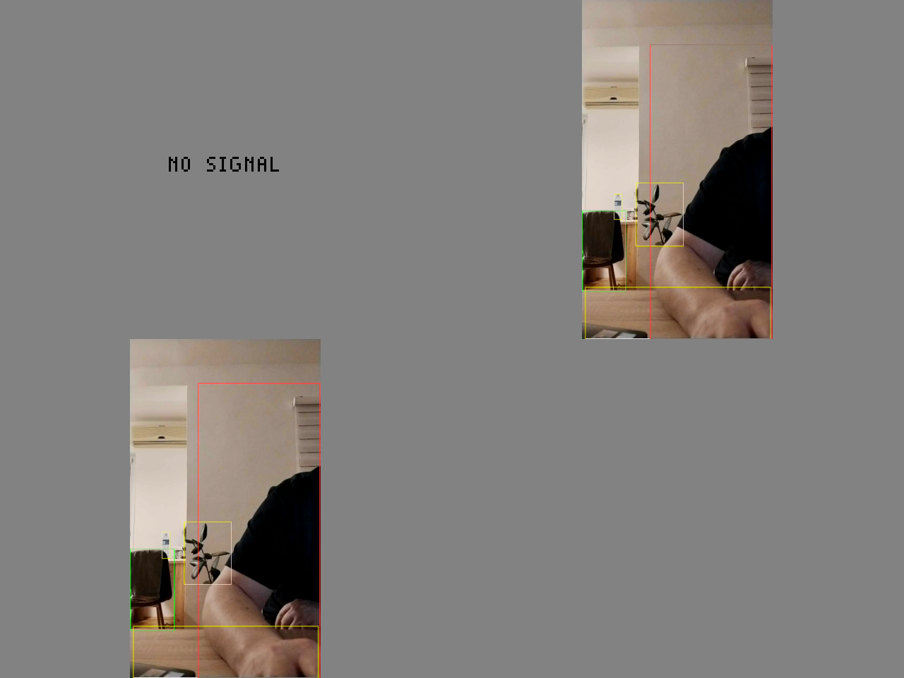
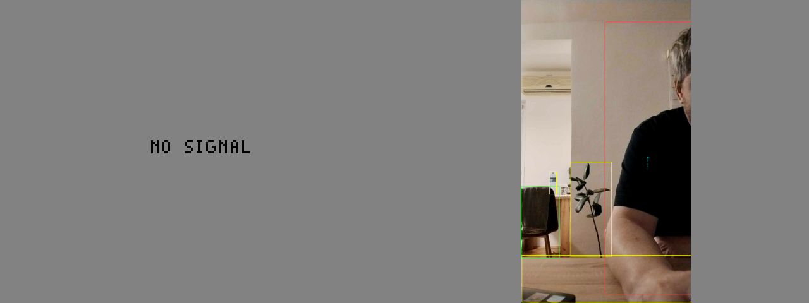

# `light_ai` — Zero-Copy Video Analytics on RK3588

[](LICENSE)
[-green.svg)](docs/development.md#prerequisites)
[](CMakeLists.txt)
[](docs/development.md#tests)

Zero-copy hardware-accelerated object detection, Kalman tracking, optional OSNet cross-camera Re-ID, and multi-camera H.264 streaming pipeline for Rockchip RK3588 (`V4L2` / HTTP MJPEG → `MPP` decode → `RGA3` letterbox & rotation → `RKNN` NPU + async Re-ID → `Mali G610` EGL/GLES box, EN/RU callout & trail overlay → `MPP` H.264 / MPEG-TS). Built in C++17 with no GStreamer, no OpenCV, no CPU pixel copies, and no virtual dispatch on the frame path.

[Live Captures](#live-captures) · [Quickstart](#quickstart) · [Architecture](#architecture) · [Performance](#measured-performance) · [CLI](#run--cli-reference) · [Docs](#documentation--licenses)

## Live Captures

Sample output frames captured directly from the encoded H.264 preview stream on the RK3588 board (`yolov5s_relu_int8_mmse_v5.rknn`, `GpuBoxDrawer` + Kalman `Tracker` + `TrailWindow`):

| Single Camera: Seated Person & Multi-Class (`640×480`) | Single Camera: Walking Detection & Trail (`640×480`) |
|---|---|
|  |  |
| **Multi-View `2×2`: `NO SIGNAL` Failover (`1280×960`)** | **Multi-View `2×2`: 3 Active Mixed-Aspect Streams (`1280×960`)** |
|  |  |

<details>
<summary>🔹 <kbd>Expand</kbd> <strong>More captures: Dual Source 2×1 (1280×480)</strong></summary>

| Dual Source `2×1`: Live Tracking + `NO SIGNAL` (`1280×480`) | Dual Source `2×1`: V4L2 + Portrait HTTP MJPEG (`1280×480`) |
|---|---|
|  |  |

</details>

## Quickstart

**Target environment:** Rockchip RK3588 / RK3588S (`aarch64`, Debian 11 / `5.10.226-preempt`, `>= 4 GB` RAM; keep repo and builds on external NVMe / USB SSD to avoid internal eMMC wear). For full hardware, kernel `bootargs`, `ffmpeg-rockchip` 8.1, RKNPU2 `2.5.0`, and `clang-tidy` venv setup, see [`docs/development.md#prerequisites`](docs/development.md#prerequisites).

**Models (not tracked in Git):** place `.rknn` weights in `misc/` (or pass `--model` / `--reid-model`):
- `misc/yolov5s_relu_int8_mmse_v5.rknn` *(required)*
- `misc/osnet_x1_0_imagenet.rknn` *(optional, cross-camera Re-ID)*

Run from `light_ai/`:

```bash
# 1. Release build + host unit tests (72 suites / 10,210 checks) + TSan (11 suites / 6,207 checks) + 2-pass clang-tidy
./scripts/build.sh

# 2. Host unit + TSan tests standalone (no Rockchip/FFmpeg/EGL SDKs needed)
./scripts/test.sh

# 3. Live inference + H.264/MPEG-TS TCP pull preview on port 1234
sudo -n ./build/light_ai --device /dev/video20 --pool 3 --net --net-h264 --net-fps 0
```

Connect a viewer on the LAN:

```bash
ffplay -fflags nobuffer tcp://<board-ip>:1234
```

*(For simultaneous multi-viewer streaming on port `1236` via the on-demand A55 fan-out relay, see [`modules/ts_fanout/README.md`](modules/ts_fanout/README.md). For Windows `mpv` configuration and latency tuning, see [`docs/viewer.md`](docs/viewer.md).)*

## Architecture


One frame's path: V4L2 or HTTP MJPEG → `MppDecoder` (dma-buf YUV) → `RgaResizer` letterbox into a pool tensor → `InferencePool` (`RknnEngine` + `YoloDecode`) → `BoxSmoother` + `Tracker` (+ optional Re-ID) → *(when a viewer is attached)* `OverlaySink` → `FrameComposer` → `H264Encoder` → `PacketQueue` → `MuxSession` (MPEG-TS over TCP pull or UDP).

### Output vs. Recognition State Machine

| Sources | No viewer attached | Viewer attached |
|---|---|---|
| **`>= 1` source live** | **Recognition runs** (capture, MPP decode, RKNN inference, Kalman tracking, optional Re-ID); **output sleeps completely** — no GPU/CPU draw, no RGA compose, no `NO SIGNAL` tiles, no H.264 encode (`enc` = `0.0 ms`). | **Full pipeline:** live sources run draw/compose/encode; disconnected slots show the pre-rendered gray `NO SIGNAL` tile (`IdlePlate`: DejaVu label font, 21 px capitals, no outline). |
| **All sources absent** | **Recognition sleeps** (NPU/Re-ID workers parked on condition variables); **output sleeps** (`enc` = `0.0 ms`). | **Recognition sleeps** (workers parked); output serves the pre-rendered gray `NO SIGNAL` tile (`IdlePlate`). |

### Key Invariants

- **Zero-copy `dma-buf` pipeline:** Decoded YUV frames, RGA-letterboxed RGB888 NPU tensors, Mali G610 overlays, and H.264 NV12 encoder inputs stay in `dma-buf` memory. CPU reads occur only when `--dump-cal` or `--cal` dumps a calibration PPM (`DmaSync`).
- **Canonical stream canvases (`NetEncoder`):** `1` source → `640×480` (letterbox band cropped 1:1 from NPU tensor); `2` sources → `1280×480` (`2×1`); `3–4` sources → `1280×960` (`2×2`, unused 4th cell stays gray). Multi-view sessions start on a gray canvas and hold frame `0` (IDR) until all configured tiles refresh or `200 ms` elapses (`SessionWarmup`).
- **Thread & CPU affinity (`Pipeline`):** `AsyncLogSink` runs on Cortex-A55 (`cpu 0–3`), `SourceProber` runs on a dedicated background thread spawned before `Pipeline::run()` pins RT threads to Cortex-A76 (`cpu 4–7`, `cpu_affinity.hpp`): `pipeline main` (`cpu 4`, `SCHED_FIFO 80`), NPU pool workers (`--pool 3`, `cpu 5–7`, `SCHED_FIFO 70`), and `StreamOutput` (`A76`, `SCHED_FIFO 60`), with `mlockall`/`mallopt` and automatic `SCHED_OTHER` fallback when unprivileged. With `--reid-model`, `ReidWorker` (`BasicReidQueue`) runs an additional `SCHED_OTHER` async RKNN thread for person crops.

For the full module & header map (104 headers / 62 translation units), error model & exit codes, and verified RK3588 hardware/SDK constraints, see [`docs/architecture.md`](docs/architecture.md).

## Measured Performance

| Configuration | Resolution / Model | Steady Timing Breakdown (`ms`) | Throughput |
|---|---|---|---|
| Camera-bound baseline (M1) | `1920×1080` MJPEG, `mobilenet_v1` (`224×224`) | `cam 35.0–43.4`, `dec 2.4`, `rga 2.3`, `infer 2.0` | `~20–24 FPS` (evening); `30.0 FPS` @ `640×480` day |
| NPU-bound FP32/FP16 (M2.1) | `1280×720` MJPEG, `yolov5s_relu` (`640×640`) | `cam ~10`, `infer 46.9–47.7` | `~16.8 FPS` |
| Steady INT8 (`720p`) | `1280×720` MJPEG, `yolov5s_relu_int8` + viewer | `sum ~38` (CPU/GPU draw parity; GPU subpixel quality) | `~26 FPS` |
| **Current default (`960p` INT8)** | `1280×960` MJPEG, `yolov5s_relu_int8_mmse_v5` + H.264 viewer | `cam 14.4–18.2`, `dec 1.3–1.4`, `rga 1.1`, `infer 29.0–30.3`, `enc 1.0–1.4` (`DRM_PRIME`), `sum 49.5–50.2` | `~20.0 FPS` *(source-bound)* |
| Multi-view `2×1` (`--pool 3`) | `2` mixed sources, `1280×480` H.264 compose | `enc 0.9–1.3` | `~49.4–50 FPS` combined |
| Layer A replay + Re-ID (`--pool 3`) | `1063` frames (`1280×960`), `osnet_x1_0_imagenet.rknn` | OSNet `~6.1 ms/crop`; `L1..L6 -> G1` | `29.615 FPS` |
| Live 3-cam `2×2` + Re-ID + `--src-rot 270` | `USB + 2× HTTP MJPEG`, `--label-lang ru`, H.264 | async Re-ID off critical path | `66.102 FPS` combined |
| Pure NPU (`tools/bench_npu`) | `yolov5s_relu_int8`, `performance` governors | `15.4 ms` (`3` cores), `18.1 ms` (`2` cores), `22.0 ms` (`1` core) | `~65 FPS` pure NPU ceiling |

## Run & CLI Reference

```bash
# Multi-camera (up to 4 sources) with RGA rotation, Russian callouts, and cross-camera OSNet Re-ID
sudo -n ./build/light_ai \
    --device /dev/video20 \
    --net-src http://<cam1-host>:8080/video \
    --net-src http://<phone-host>:8080/video --src-rot 270 \
    --reid-model ./misc/osnet_x1_0_imagenet.rknn --reid-thr 0.62 \
    --label-lang ru --pool 3 --net --net-h264 --net-fps 0 --net-bitrate 3000 --frames 3000

# Production profile via INI config (copy template once; CLI flags override INI):
cp scripts/light_ai.ini.example build/light_ai.ini
./scripts/run.sh --log-level warn --frames 600

# Legacy UDP push viewer (explicit IPv4 bind required on Windows):
ffplay -fflags nobuffer -flags low_delay -framedrop -probesize 32 -analyzeduration 0 -vf setpts=0 -f mpegts udp://0.0.0.0:1234
```

**Runtime notes:**
- **Busy port resilience:** If `--net-port` is in use, `retry_listen()` logs one warning and retries every `2 s` while recognition continues uninterrupted.
- **Source size change:** If a source reconnects at another resolution, `SourceChannel` re-initializes its decoder (`source sN: geometry changed A -> B, re-initializing the decoder`) and resets that source's tracks and orientation.
- **Graceful shutdown:** `ProcessEnv` + `SignalWaiter` handle `SIGINT`/`SIGTERM` without globals during `Pipeline::run()`, draining the pool, printing `TOTAL` timings, flushing `h264_rkmpp`, and calling `STREAMOFF`.
- **File ownership after `sudo`:** Restore ownership of `build/cal.ppm` / `dataset/` created under `sudo` with `sudo -n chown -R "$(id -un):" build dataset`.

<details>
<summary>🔹 <kbd>Expand</kbd> <strong>Full CLI &amp; INI option reference (28 options + <code>--help</code> in <code>src/config/option_registry.cpp</code>)</strong></summary>

All **28 options** (plus `--help` / `-h`) are shared between the CLI parser and `--config` INI files (up to **4** video sources across `1×1`, `2×1`, or `2×2` grid). INI files (`key = value`) are applied **before** CLI flags so CLI flags always override. Missing camera nodes fall back via `UsbNodeLocator`; busy nodes stay `Detached` and are retried every `2 s` by `SourceProber`.

| Flag&nbsp;&nbsp;&nbsp;&nbsp;&nbsp;&nbsp;&nbsp;&nbsp;&nbsp;&nbsp;&nbsp;&nbsp; | Description & Default |
|---|---|
| `--help`,&nbsp;`-h` | Print generated option list and exit `0`. |
| `--config` | `<path>` — Load flat `key = value` INI config before CLI flags *(default: none)*. |
| `--device` | `<path>` — V4L2 camera device, repeatable up to 4 total sources into `Config::sources` *(default: `/dev/video20`)*. |
| `--net-src` | `<url>` — HTTP MJPEG pull source (`http://host:port/path`), repeatable up to 4 total sources *(default: none; see DNS note below)*. |
| `--src-rot` | `0\|90\|180\|270` — Override automatic source orientation detection via RGA *(default: `auto`)*. |
| `--model` | `<path>` — RKNN detector model path *(default: `./misc/yolov5s_relu_int8_mmse_v5.rknn`)*. |
| `--reid-model` | `<path>` — Re-ID RKNN model path for cross-camera global IDs; `none` or `off` disables *(default: `./misc/osnet_x1_0_imagenet.rknn`; see RGA crop note below)*. |
| `--reid-thr` | `0.0..1.0` — Re-ID cosine similarity threshold *(default: `0.62`)*. |
| `--label-lang` | `en\|ru` — Callout label language: `Person #N` vs. `Человек #N` *(default: `en`)*. |
| `--label-scale` | `1..4` — Callout text size: `11 px` font (~`8 px` capitals) per step on output tile; `place_tile` scale compensated; `3..4` magnify the 22 px atlas *(default: `1`)*. |
| `--log-level` | `debug\|info\|warn\|error\|off` — Diagnostic log threshold: `debug`/`info` on `stdout`, `warn`/`error` on `stderr` *(default: `info`)*. |
| `--conf` | `0.0..1.0` — Detection confidence threshold *(default: `0.25`)*. |
| `--iou` | `0.0..1.0` — NMS IoU threshold *(default: `0.45`)*. |
| `--core` | `0\|1\|2\|3\|4\|7` — NPU core mask (`0` auto, `1/2/4` = core 0/1/2, `3` = 0+1, `7` = 0+1+2; ignored when `--pool > 1`) *(default: `0`)*. |
| `--pool` | `0\|1\|3` — NPU context pool (`0\|1` = single context, `3` = 3 parallel engines across cores 0–2) *(default: `0`)*. |
| `--frames` | `>= 1` — Stop cleanly after `N` frames; `0` runs until `SIGINT`/`SIGTERM` *(default: `0`)*. |
| `--net` | Enable network preview server (raw RGB24 NUT unless `--net-h264`) *(default: `false`)*. |
| `--net-h264` | Encode preview with `h264_rkmpp` inside MPEG-TS *(default: `false`)*. |
| `--net-port` | `1..65535` — Preview TCP listen port or UDP destination port *(default: `1234`)*. |
| `--net-host` | `<ip/host>` — Optional UDP push destination (H.264 push); unset = TCP pull server *(default: `""`)*. |
| `--net-fps` | `0..120` — Preview stream FPS; `0` = VFR follow-source timestamps *(default: `25`)*. |
| `--net-gop` | `0..300` — H.264 GOP size in frames; `0` = auto 1 s at configured/nominal FPS *(default: `0`)*. |
| `--net-bitrate` | `1000..100000` — H.264 encoder CBR bitrate in kbps (`1500–3000` is plenty for `640×480`) *(default: `12000`)*. |
| `--cpu-draw` | Force CPU box/trail/callout drawing (`A/B` baseline vs. Mali GPU drawer) *(default: `false`)*. |
| `--cal` | `1..10000` — Save up to `N` model-input frames (`cal_%04d.ppm`) for INT8 calibration *(default: `0`, off)*. |
| `--cal-interval` | `1..10000` — Calibration sampling stride (saves frames `0, K, 2K, ...`) *(default: `15`)*. |
| `--cal-dir` | `<path>` — Redirect directory for `--cal` series and `--dump-cal` (requires `--cal` or `--dump-cal`) *(default: `dataset/` & `build/`)*. |
| `--dump-cal` | Dump first eligible model-input frame to `build/cal.ppm` (or `<cal-dir>/cal.ppm`) *(default: `false`)*. |
| `--box-log` | `<path>` — Write per-frame raw vs. smoothed bounding-box CSV (`A/B` / Layer A) *(default: `""`, off)*. |

- **`--net-src` DNS resolution:** A numeric IPv4 host needs no DNS; a hostname is resolved on every (re)connect without blocking the prober for long — lookup is bounded to `5 s` (plus up to `5 s` for TCP connect) and abandoned within `100 ms` on stop. A lookup glibc cannot cancel is waited for at exit, at most the resolver's own timeout (`/etc/resolv.conf` `timeout` × `attempts` per nameserver).
- **`--reid-model` RGA crop limit:** Re-ID crops the detector input in one RGA pass; a detector input over `8×` the Re-ID input on a side (e.g. `1280` into OSNet `128×256`) logs one error and leaves Re-ID off while recognition continues.

</details>

## Documentation & Licenses

| Document | Scope |
|---|---|
| [`docs/architecture.md`](docs/architecture.md) | 104-header / 62-TU module map, `core/` pure-logic inventory, error model & exit codes, and verified RK3588 hardware/SDK constraints. |
| [`docs/development.md`](docs/development.md) | Hardware/kernel/SDK prerequisites, `ffmpeg-rockchip` 8.1 build, CMake flags, `clang-tidy` / `clangd` operations, 72 test suites, and `scripts/` + `tools/` index. |
| [`modules/ts_fanout/README.md`](modules/ts_fanout/README.md) | Standalone A55 MPEG-TS multi-viewer TCP fan-out relay (`:1234 → :1236`). |
| [`docs/viewer.md`](docs/viewer.md) | Legacy Windows laptop `mpv` viewer guide and latency notes. |
| [`CONTRIBUTING.md`](CONTRIBUTING.md) | Coding rules (`gate` vs `review`), error/exception policy, comment style, and PR verification gate. |
| [`CLAUDE.md`](CLAUDE.md) | On-board developer workflow, USB replug commands, and audit stage notes. |
| [`docs/roadmap.md`](docs/roadmap.md) & [`docs/state.md`](docs/state.md) | Milestone tracker (`M1–M3.10`, `M5`, `M6`), INT8 quantization lineage (`v1–v5`), and A/B validation logs. |
| [`reference/README.md`](reference/README.md), [`tests/data/README`](tests/data/README), [`misc/README.md`](misc/README.md) | Layer A / Layer B reference detection contracts and local model inventory. |

**Licensing:** `light_ai` source code is licensed under the **[MIT License](LICENSE)**. Third-party dependencies (`inih` BSD-3-Clause, DejaVu Sans glyph data (Bitstream Vera license), `rockchip_mpp`/`librga` Apache-2.0, `FFmpeg` LGPL-2.1+/GPL note, `librknnrt.so` proprietary Rockchip runtime, and untracked `YOLOv5` / `OSNet` `.rknn` models) are detailed in **[`THIRD_PARTY_LICENSES.md`](THIRD_PARTY_LICENSES.md)**.
